<p align="center">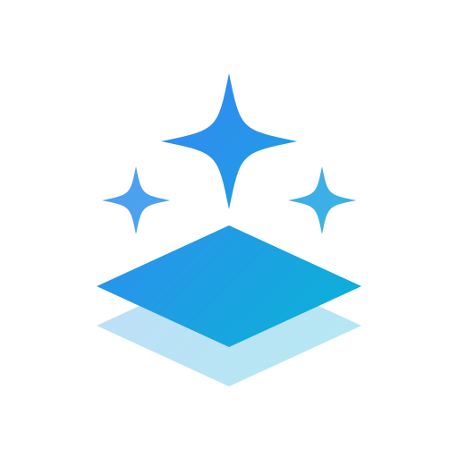</p>

<h1 align="center">Agent Loft</h1>

<p align="center"><b>把 Claude Code 和 Codex 放到一张工作台上统一管理，在网页、飞书和 Mac 桌面端随时驱动，进展推送到飞书、iPhone 和 Mac。</b></p>

<p align="center">服务端 v0.2.20 · 桌面端 v0.1.7（macOS / Windows / Linux）</p>

---

## 产品简介

Agent Loft 是一个装在你自己电脑上的 AI 编程 agent 工作台。

它把 **Claude Code** 和 **Codex** 放到同一个地方统一管理：在电脑上，你用**完整的 Web 页面**和它们协作；出门在外，你在**飞书**里给它们派活，还能把网页上做了一半的任务**接到飞书里继续**。任务完成、出错或需要你授权时，**飞书消息和 iPhone、Mac 的系统通知**都会提醒你。如果你有好几台开发机，**Mac 桌面端**可以把它们全部接进一个窗口。

<p align="center">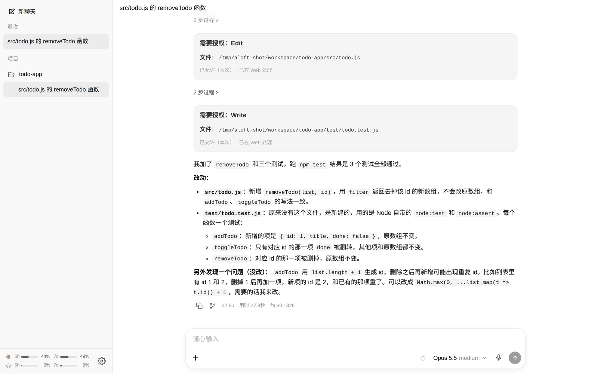<br><sub>Web 工作台：Claude Code 改完代码、跑完测试，授权记录和用时、费用一目了然</sub></p>

> Loft 在这里的意思不是阁楼，而是**工作台**：agent 是干活的人，Agent Loft 是它们共用的那张台面。Logo 上一大两小几颗星，就是几个 agent 站在同一张台面上。

### 从哪里开始读

| 你想… | 建议阅读 |
|---|---|
| 先了解产品能做什么 | [六大核心亮点](#六大核心亮点) → [核心亮点详解](#核心亮点详解) |
| 马上装起来用 | [基本概念](#基本概念) → [快速上手](#快速上手) |
| 在手机上用、收推送 | [在手机上使用](#在手机上使用) → [开启系统推送](#开启-iphone--ipad--mac-系统推送) |
| 接入飞书 | [接入飞书机器人](#接入飞书机器人一对一或一对多) → [在飞书里续接 Web 任务](#在飞书里续接-web-任务) |
| 用 Mac 管理多台机器 | [用 Mac 桌面端接入多台服务器](#用-mac-桌面端接入多台服务器) |
| 查功能、命令、设置项 | [功能清单](#功能清单) → [命令速查](#命令速查) → [设置页一览](#设置页一览) |
| 遇到问题 | [常见问题](#常见问题) → [故障排查](#故障排查) |

---

## 六大核心亮点

| | 亮点 | 一句话说明 |
|---|---|---|
| 🤖 | **同时管理多个 agent** | Claude Code 和 Codex 共用一套会话列表、工作目录和授权流程，同一条会话里随时切换 |
| 🔀 | **飞书机器人灵活绑定 agent** | 一个机器人可以只对应一个 agent，也可以同时对应多个，在设置页勾选即可 |
| 🔗 | **飞书续接 Web 任务** | 网页上开始的任务，在飞书里接上后可以继续查看、回复和授权，回到电脑前再接着在网页上做 |
| 🖥️ | **完整的 Web 工作台** | 聊天、附件、语音、模型切换、分叉、会话管理和所有设置都在网页上，电脑和手机都能用 |
| 🔔 | **飞书 + 苹果系统推送** | 除了飞书消息，还能推送到 iPhone、iPad 锁屏和 Mac 通知中心，图标上显示未读数 |
| 🗂️ | **桌面端同时接入多台设备** | 一个 Mac 应用同时连接家里、公司、云上的多台服务器，菜单栏一眼看完各台的额度和待办 |

---

## 为什么需要 Agent Loft

| 你可能遇到的情况 | Agent Loft 的做法 |
|---|---|
| Claude Code 和 Codex 各开一个终端，会话各记各的 | 一个会话列表管理所有 agent，同一条会话里随时切换 |
| 想给自己、团队、不同项目分别配飞书机器人 | 想配几个就配几个，每个机器人能用哪些 agent 由你决定 |
| 在电脑上让 agent 跑长任务，人一出门就断了联系 | 在飞书里接上这条 Web 会话，用手机继续看进度、批授权、补充要求；家里没有公网 IP 也行 |
| 只用飞书的话，在聊天框里看代码、管会话都不方便 | 细活在完整的 Web 页面上做，飞书负责随时随地处理 |
| 不想一直盯着屏幕等 agent 跑完 | 跑完、出错、需要授权时，飞书、iPhone、Mac 都会提醒 |
| 有好几台开发机，来回登录很麻烦 | Mac 桌面端同时连接多台服务器，点标签就能切换 |
| 担心代码和凭据被传到第三方平台 | 服务跑在你自己的机器上，Agent Loft 只做遥控，不经过任何中转服务器 |

---

## 核心亮点详解

### 🤖 亮点一：同时管理多个 agent

不用再在 Claude Code 和 Codex 的终端之间来回切换。

- **两大 agent 同时在线**：Claude Code 通过官方 Claude Agent SDK 接入，Codex 通过官方 `codex app-server` 接入，用的都是官方接口，你配置好的 skills、`/compact` 等原生命令照样能用。
- **同一条会话随时切换**：发送 `/claude`、`/codex` 或 `/agent` 即可切换。每个 agent 保留自己的上下文，切回来时会接着它上次的进度继续。
- **共用工作目录，分工协作**：两个 agent 在同一个工作目录里干活，能看到对方改过的文件。比如让 Claude 写完代码，切到 Codex 审查目录里的改动。注意两者的聊天记录不互通，需要的话把 Codex 的审查意见转述给 Claude 即可。
- **一套操作管所有 agent**：会话列表、授权、模型和思考程度切换、命令补全都是同一套，不用学两遍。
- **多个任务并行**：多条会话可以同时运行。侧栏里正在运行的会话显示转圈，等你处理的会话显示提示点。
- **额度集中查看**：侧栏底部同时显示 Claude 和 Codex 的订阅额度（5 小时和 7 天两个窗口），以及多久后重置。
- **方便接入新 agent**：Agent Loft 只负责接入和管理，不自己做模型，也不改变 agent 的行为。以后有新的 agent，写一个驱动就能接进来。

<p align="center">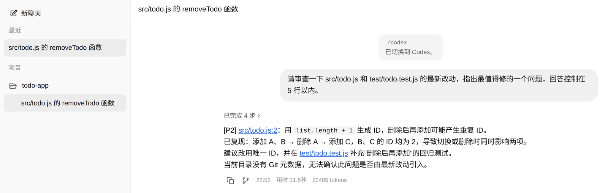<br><sub>发送 /codex 切换后，Codex 直接审查 Claude 刚改过的文件</sub></p>

### 🔀 亮点二：一个飞书机器人对应一个 agent，也可以对应多个

在 **设置 → 飞书机器人** 里，每个机器人都有一项「可用的 Agent」：

| 配置方式 | 适合场景 | 使用体验 |
|---|---|---|
| **一个机器人对应一个 agent**（只勾一个） | 想要「Claude 助手」「Codex 助手」两个机器人，各管各的 | 找哪个机器人就是用哪个 agent，不用记切换命令 |
| **一个机器人对应多个 agent**（勾选多个） | 只想加一个机器人，按需换 agent | 新会话用你设定的默认 agent，聊天时用 `/claude`、`/codex`、`/agent` 切换 |

<p align="center">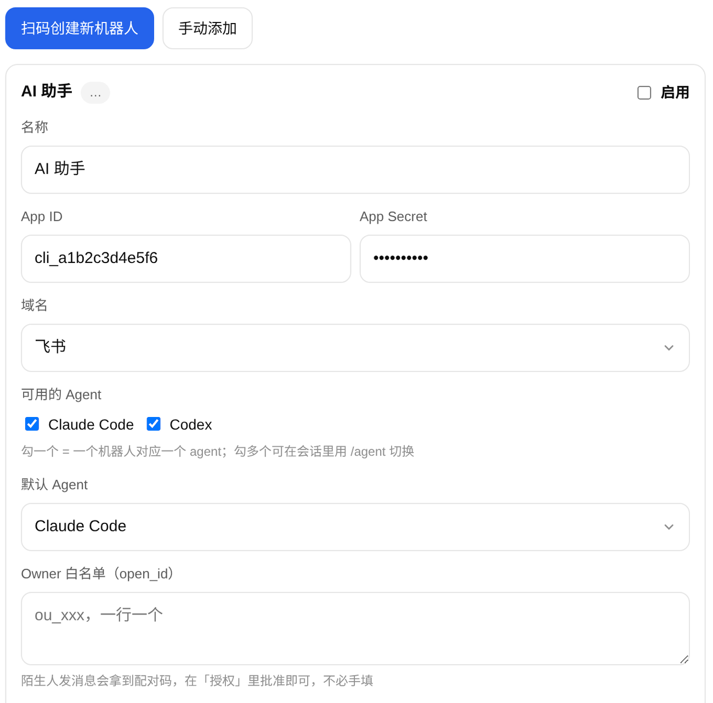<br><sub>在「可用的 Agent」里勾一个或多个，决定这个机器人能用哪些 agent</sub></p>

- **机器人数量不限**：可以给自己、团队群、不同项目各配一个，每个机器人能用的 agent 单独设置。
- **不需要公网地址**：机器人靠服务端主动连向飞书的长连接收发消息。家里没有公网 IP、没配 HTTPS，出门在外也能用飞书遥控。
- **扫码就能创建**：在网页上用飞书扫码，App ID、App Secret 自动填好，扫码人自动加入白名单，不用去飞书开发者后台抄配置。
- **改完立即生效**：增删机器人、修改绑定的 agent 都不用重启服务。
- **访问可控**：不在白名单里的人给机器人发消息只会收到一个配对码，你在网页上批准后对方才能使用。每个机器人单独授权，在 A 机器人上被批准，不代表能用 B 机器人。

### 🔗 亮点三：飞书机器人可以续接 Web 任务

网页和飞书不是两个孤立的入口，而是**同一条任务的两个窗口**。

**典型场景**：你在电脑上用网页让 agent 重构一个模块，任务还没跑完，你要出门了。

1. **接上**：在飞书里给机器人发送 `/web`，在列出的最近 10 条 Web 会话里点「接上」。也可以出门前在网页侧栏右键这条会话，选择「在飞书继续…」。
2. **在飞书里继续**：之后 agent 的回复、授权请求和提问都会发到飞书。你在飞书里说的话、发的命令也会进入这条 Web 会话。
3. **回到电脑前**：网页上是完整的对话记录，包括你在飞书里说的话，直接接着做。
4. **断开**：在飞书里发送 `/detach`，这个飞书聊天就回到它自己原来的会话。

另外：
- **授权请求会同时出现在网页和飞书上，先在哪边处理就以哪边为准**，另一边自动标为「已处理」。
- 反过来也行：飞书里发起的会话也会出现在网页侧栏里，在网页上打开就能接着聊。
- 如果在网页上删除了这条会话，飞书那边会自动退回原来的会话。

<p align="center">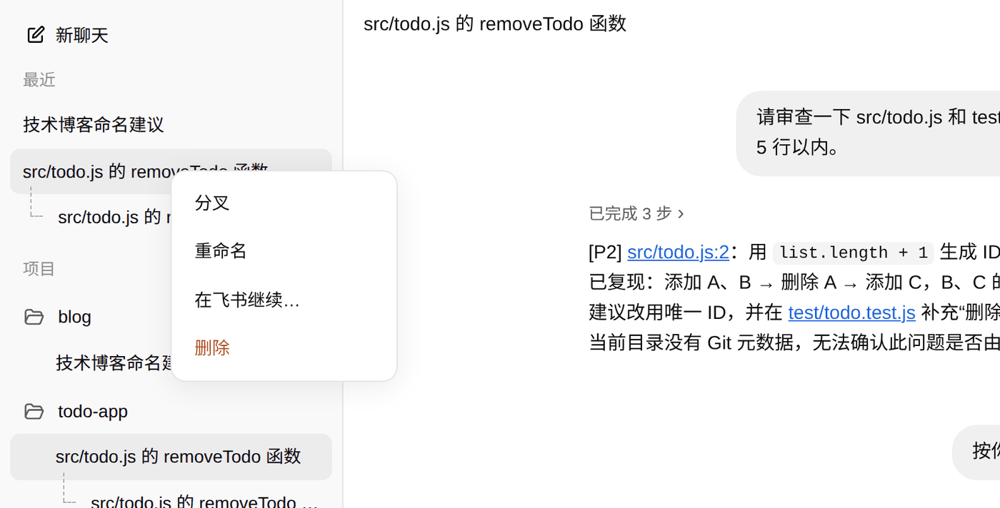<br><sub>网页侧栏右键会话，选择「在飞书继续…」</sub></p>

### 🖥️ 亮点四：完整的 Web 工作台

这不是一个简陋的遥控页面，而是一个功能齐全的工作台，界面风格接近 ChatGPT。日常使用基本不用再开终端。

- **对话**：回复逐字显示，支持 Markdown 和代码高亮，思考过程和工具调用可以折叠；每条回复下方显示用时、费用和完成时间。
- **输入**：可以粘贴、拖拽上传附件，手机上能直接拍照；支持语音输入；输入 `/` 弹出命令补全。
- **定时发送**：额度用完、要等刷新才能继续时，把下一条消息排好，选「额度重置后」或任意时间，到点自动发出，关掉页面也照发。
- **模型**：输入框右下角随时切换模型和思考程度；输入框里的小圆环显示上下文窗口用了多少。
- **会话**：侧栏按「最近」和「项目」分组，项目文件夹可以拖动排序、右键置顶；会话标题由 agent 自动生成；可以从任意一条回复分叉出新会话，分叉关系在侧栏里用虚线连起来。
- **目录**：新对话发出第一条消息前，就能在目录树里逐层点选项目目录，并选好要用的 agent。
- **设置**：工作目录、各 agent 的默认模型、Codex 沙箱、飞书机器人、配对审批、自定义命令、通知、登录设备、服务端升级，全部在网页上完成，**改完立即生效**。
- **手机上同样好用**：「添加到主屏幕」后可以像 App 一样全屏使用；切到后台再回来会自动重连，并补上错过的内容。

<p align="center">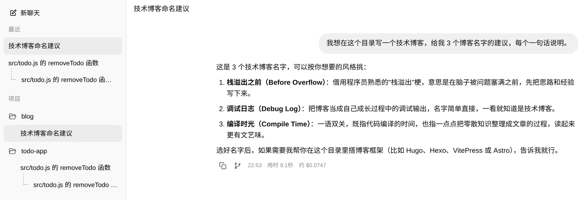<br><sub>侧栏按「最近」和「项目」分组，分叉出来的会话用虚线挂在原会话下面</sub></p>

<p align="center">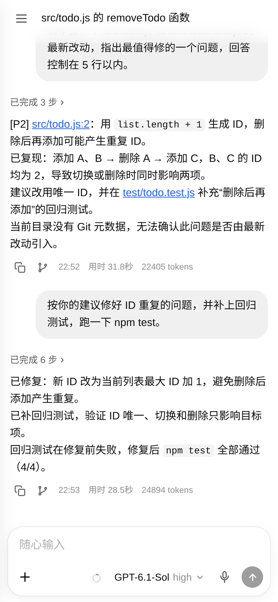 &nbsp; 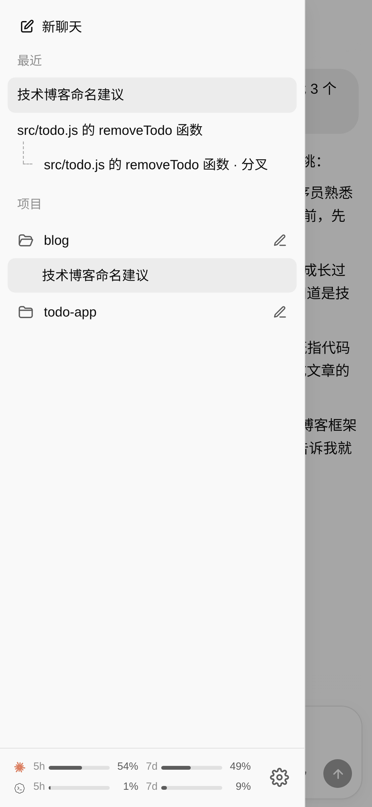</p>
<p align="center"><sub>手机上同样是完整的工作台</sub></p>

### 🔔 亮点五：飞书推送之外，还有苹果系统推送

Agent 跑完了、出错了、需要你授权或回答问题时，会通过以下方式提醒你：

| 推送方式 | 适用设备 | 送达位置 | 怎么开启 |
|---|---|---|---|
| **飞书消息** | 装了飞书的任何设备 | 飞书聊天 | 接入飞书机器人即可；回复、授权卡、提问卡直接发到聊天里，在卡片上点一下就能处理 |
| **iOS 系统推送** | iPhone、iPad（iOS 16.4 及以上） | 锁屏、通知中心、主屏幕图标角标 | 把网页「添加到主屏幕」，从图标打开后在设置里开启 |
| **macOS 系统推送** | Mac | 通知中心 | 在 Safari 或 Chrome 里开启；也可以直接用 Mac 桌面端，自带系统通知和程序坞角标 |
| **其他系统推送** | Android、Windows 等 | 系统通知栏 | 在 Chrome、Edge 或 Firefox 里开启 |

- **不需要开发者账号**：采用浏览器标准的 Web Push，不用申请苹果开发者账号，也不用接入第三方推送服务。
- **推送内容加密**：苹果、谷歌等推送服务器只负责转发，看不到通知的内容。
- **按设备管理**：在 **设置 → 通知** 里为每台设备单独开启或关闭，开启后可以发一条测试通知确认；打开页面后，图标上的未读数自动清零。
- **不打扰**：系统推送负责 Web 会话；飞书会话由飞书自己提醒，不会重复推送。你正在前台看着的那条会话也不会推送。

<p align="center">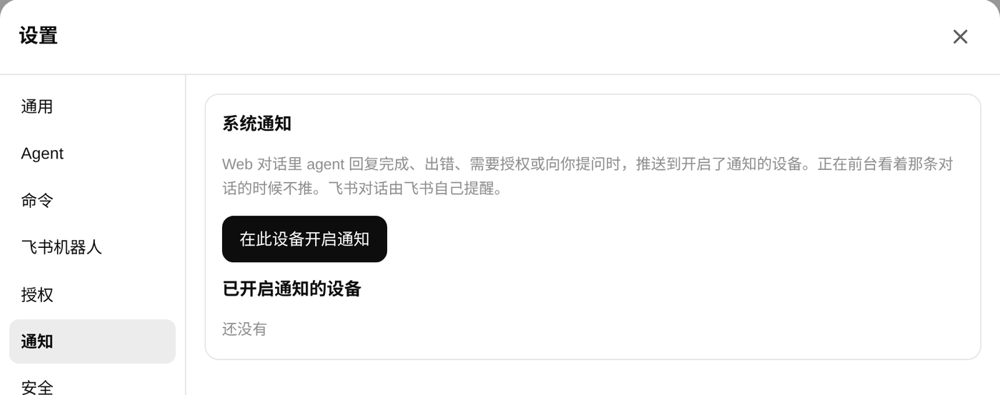<br><sub>在 设置 → 通知 里为当前设备开启系统推送</sub></p>

### 🗂️ 亮点六：桌面端同时接入多台设备

家里一台 NAS、公司一台工作站、云上一台服务器？Mac 桌面端可以把它们集中到一个窗口里。

- **多台服务器同时在线**：顶部标签栏切换服务器，可以拖动排序。每台服务器各自登录；切到其他服务器时，原来那台仍在后台保持连接。
- **任意一台有动静都会提醒**：不管是哪台服务器上的任务跑完了、需要授权了，都会弹出 macOS 系统通知，程序坞图标上显示未读数。关掉窗口后桌面端仍在菜单栏运行，通知照常弹出。
- **菜单栏总览**：鼠标移到菜单栏图标上，就能看到每台服务器的 Claude / Codex 额度、待处理和运行中的会话；双击图标打开主窗口。
- **额度不重复查询**：多台服务器登录的是同一个账号时，额度只查一次。
- **本机也能当服务端**：首次启动时可以选「这台 Mac 也作为服务端」，一键安装并设为开机自启。还可以开启「本机有会话在跑时不休眠」，避免任务跑到一半 Mac 睡着了。
- **支持 Cloudflare Access**：服务器前面挡着 Cloudflare Access 时，验证页直接在窗口里完成，过期会提醒；也可以配置 Service Token 免验证。
- **在桌面端里升级服务器**：桌面端设置的服务器列表里能看到每台服务器的版本，有新版本时点「升级服务端」即可。

---

## 更多特点

### 让 agent 放手干，关键操作由你把关
- Agent 要执行命令或修改文件时会弹出授权卡，你可以选择**允许一次**、**本会话全部允许**、**总是允许**或**拒绝**（不同操作提供的选项略有不同）。
- 发送 `/autoedit on`，Claude Code 在这条会话里修改工作目录内的文件就不再询问，执行 Bash 命令仍会询问。
- **授权超时一律按拒绝处理**，绝不会默认放行。

### 跑在你自己的机器上，安全可控
- 代码、凭据和会话记录都留在本机。
- 登录密码用 scrypt 哈希保存；首次建管理员必须输入启动日志里的一次性设置码；同一 IP 连续输错 5 次锁定 15 分钟。
- Agent 运行时拿不到 Agent Loft 自己的凭据（飞书密钥等环境变量会被剔除）。
- Codex 默认使用 `workspace-write` 沙箱，越出工作目录的操作必须经过授权。

### 开箱即用，几乎不用维护
- 一条 `npm install -g` 命令完成安装，不需要编译。
- 设置改完立即生效，不用重启，包括端口和局域网访问开关。
- 服务端有新版本时在设置里点「升级」，升级完成后，打开着的页面会自动刷新。
- **设置 → Agent** 里能检查 Claude Code、Codex 有没有装好、有没有登录；Codex 没装时点「直接在服务器上安装」即可。

---

## 基本概念

开始之前，先看一眼 Agent Loft 是怎么工作的：

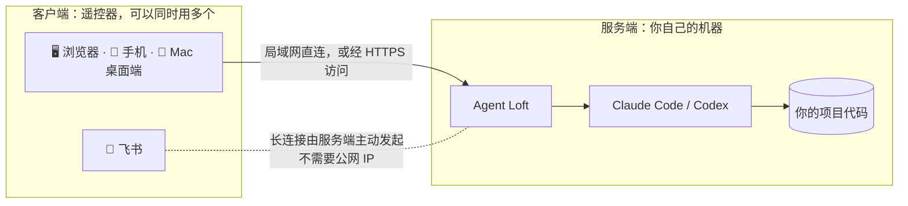

再了解几个贯穿全文的词：

| 概念 | 含义 |
|---|---|
| **服务端** | 装了 Agent Loft、真正运行 Claude Code 和 Codex 的那台机器，比如家里的 Mac mini、NAS 或云服务器。代码和凭据都在这台机器上 |
| **客户端** | 你用来操作的地方：浏览器、手机、飞书、Mac 桌面端。它们都只是遥控器，可以同时用多个 |
| **工作目录** | Agent 干活的项目文件夹。设置里的「工作目录」是总的根目录，每条会话可以在它下面选一个具体项目 |
| **会话** | 你和 agent 的一段连续对话，agent 会记住会话里的上下文。网页上开始的叫 Web 会话，飞书里开始的叫飞书会话。飞书会话可以在网页上打开，Web 会话也可以接到飞书里继续 |
| **授权** | Agent 执行命令、修改文件前征求你的同意。在任何一个客户端上点都可以 |

---

## 快速上手

### 准备工作
- **一台常开的电脑作为服务端**，系统为 Linux 或 macOS（暂不支持 Windows）。
- **Node.js 22 或更高版本**。在终端运行 `node -v` 查看版本；没装的话，可以从 [nodejs.org](https://nodejs.org) 下载，或者在 macOS 上用 `brew install node` 安装。
- **一个 Claude 或 ChatGPT 账号**，至少有其中一个：
  - Claude Code 已经随 Agent Loft 一起安装，只需要登录；
  - Codex 需要另外安装，可以在设置页里一键安装。

### 第 1 步：安装并启动

```bash
npm install -g agent-loft
agent-loft start
```

启动日志里会打印一行 `还没有设置登录密码。打开页面后输入设置码：XXXXXXXXXXXX`，把这个设置码记下来。

> 设置码在设好密码之前一直有效，重启后也不变。找不到的话，可以直接运行 `agent-loft passwd`，按提示输入新密码，跳过设置码。

### 第 2 步：首次登录

1. 用浏览器打开 Agent Loft：
   - 在服务端本机上：打开 `http://localhost:8800`；
   - 在同一局域网的其他设备上：打开 `http://<服务端的 IP>:8800`。服务端的 IP 在 macOS 上可以到 **系统设置 → Wi-Fi（或网络）→ 详细信息** 里查看，在 Linux 上运行 `hostname -I` 查看。
2. 输入设置码，建一个管理员账号：用户名（不填就是 `admin`）和登录密码（至少 8 位）。

### 第 3 步：检查环境

点侧栏左下角的齿轮图标打开设置（手机上先点左上角的菜单按钮展开侧栏），进入 **设置 → Agent**，在「运行环境」里查看 Claude Code 和 Codex 的状态。没装好或没登录的话，页面上会给出要执行的命令，登录需要在**服务端的终端**里完成：

| Agent | 怎么登录 |
|---|---|
| Claude Code | 在终端运行页面上给出的命令（一般就是 `claude`），输入 `/login`，按提示在浏览器里登录，完成后输入 `/exit`。用 API Key 的话，也可以把 `ANTHROPIC_API_KEY` 写进服务端的环境变量 |
| Codex | 没装的话，在页面上点「直接在服务器上安装」，或者在终端运行 `brew install --cask codex` 或 `npm install -g @openai/codex`。然后运行 `codex login`，用 ChatGPT 账号登录；用 API Key 的话运行 `codex login --with-api-key` |

处理完回到页面，点「重新检查」，状态都变成已登录就可以了。顺便选好各 agent 的默认模型和思考程度。

<p align="center">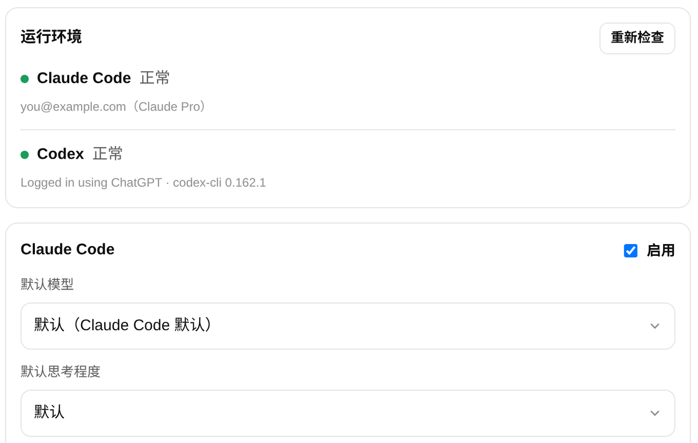<br><sub>设置 → Agent：确认 Claude Code、Codex 状态正常，再选默认模型和思考程度</sub></p>

再进入 **设置 → 通用**，把「工作目录」设为你存放项目的根目录，比如 `~/project`。所有会话都只能在这个目录之内选择和切换项目。

> 只用其中一个 agent 的话，可以在 **设置 → Agent** 里取消另一个的「启用」，新对话里就不会再出现它。

### 第 4 步：开始第一个对话

1. 点侧栏顶部的「新聊天」。
2. 点大标题里的目录名，选一个项目目录。
3. 在输入框上方选择 agent，在右下角选择模型和思考程度。
4. 输入任务并发送，比如「帮我看看这个项目的测试为什么失败」。
5. Agent 要执行命令时会弹出授权卡，选择允许或拒绝即可。
6. 想中途停下，点发送按钮（运行时会变成停止按钮），或者发送 `/stop`。

<p align="center">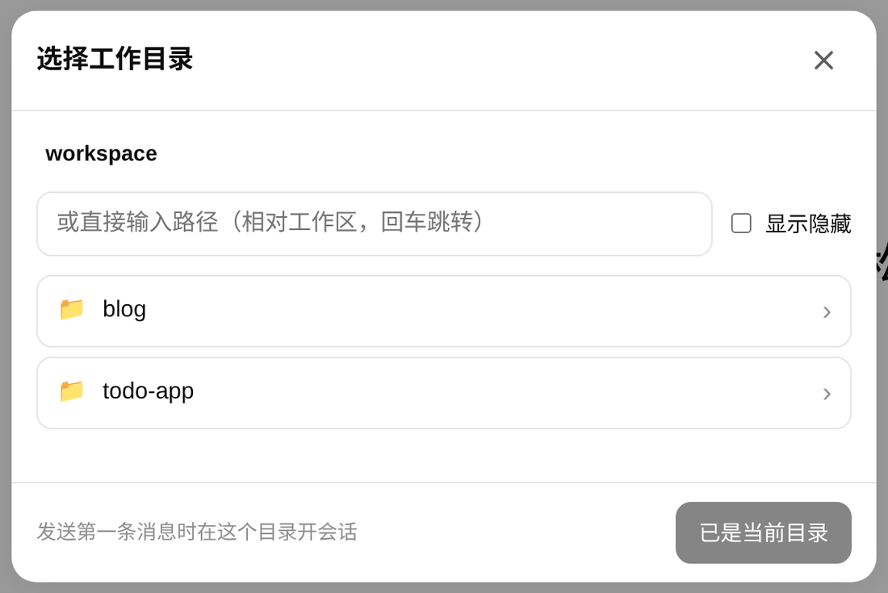<br><sub>在目录树里逐层点选项目，点「使用此目录」</sub></p>

### 第 5 步：设为开机自启

确认一切正常后，按 `Ctrl+C` 停掉前台进程，再注册为系统服务：

```bash
agent-loft service install      # Linux 用 systemd，macOS 用 launchd
```

之后电脑重启，Agent Loft 也会自动运行。

- 查看运行状态：`agent-loft service status`
- 查看日志：以服务运行时，日志在 `~/.agent-loft/logs/` 目录下（`out.log` 和 `err.log`），设置码等启动信息也会写在这里。
- Linux 上如果希望没登录桌面时也保持运行，再执行一次 `sudo loginctl enable-linger $USER`。

🎉 到这里就装好了。接下来可以按需阅读：[在手机上使用](#在手机上使用)、[接入飞书机器人](#接入飞书机器人一对一或一对多)、[用 Mac 桌面端接入多台服务器](#用-mac-桌面端接入多台服务器)。

---

## 使用指南

### 日常会话管理

| 想做的事 | 怎么做 |
|---|---|
| 开始新任务 | 点侧栏顶部的「新聊天」，或者发送 `/new` |
| 回到之前的会话 | 在侧栏里点击它；不在侧栏里的，发送 `/sessions`，在列表里点一下要恢复的会话（飞书里点「恢复这条」） |
| 中途停下 | 点停止按钮，或发送 `/stop` |
| 换一个项目 | 新对话里点大标题的目录名选择；会话进行中发送 `/cd <目录>` |
| 改会话名 | 双击侧栏里的会话，或右键选择「重命名」 |
| 删除会话 | 右键 Web 会话选择「删除」。只从列表里移除，agent 那边的会话记录还在 |
| 查看飞书里的会话 | 侧栏里每个飞书机器人单独一行，点开即可；右键选择「历史会话…」查看这个机器人的所有会话 |
| 查看当前状态 | 发送 `/status`，查看当前会话、模型、目录和剩余额度 |

几个需要知道的规则：
- **闲置太久会自动换新会话**：一条会话闲置超过 12 小时后，再发消息会开始一条新会话，避免把很久以前的上下文带进新任务。时长可以在 **设置 → 通用** 里调整，设为 0 表示永不过期。需要接着旧会话聊，用 `/sessions` 恢复即可。
- **切换工作目录会重新开始上下文**：`/cd` 之后 agent 从头开始，之前的对话不会带过去。
- **附件跟着会话走**：上传的附件存放在服务端的专用上传目录里（不会混进你的项目），开新会话或切换目录时会被清理。需要长期保留的文件，请放进项目目录。

### 在手机上使用

**在家里（同一个 Wi-Fi）：** 手机浏览器打开 `http://<服务端的 IP>:8800`，登录后就能用，可以聊天、授权、上传图片。

**在外面：** 最省事的是用飞书，不需要公网 IP 和 HTTPS，见 [接入飞书机器人](#接入飞书机器人一对一或一对多)。想在外面用网页，或者想收系统推送，就需要一个 HTTPS 地址，具体做法见 [从外网访问](#从外网访问)。用 HTTP 和 HTTPS 访问时，能用的功能有区别：

| 功能 | 局域网 HTTP | HTTPS |
|---|---|---|
| 聊天、授权、附件、会话管理、设置 | ✅ | ✅ |
| 添加到主屏幕当 App 用 | ⚠️ 可以添加，但收不到推送 | ✅ |
| 系统推送、图标角标 | ❌ | ✅ |
| 语音输入 | ❌ | ✅ |

**像 App 一样使用：** 在浏览器菜单里选择「添加到主屏幕」（iPhone 在 Safari 的分享菜单里），之后从主屏幕图标打开即可全屏使用，切到后台再回来会自动重连。

### 切换 agent 和模型

- **新对话**：发第一条消息前，在输入框上方选择 agent。
- **会话进行中**：发送 `/agent`、`/claude` 或 `/codex` 切换 agent。每个 agent 保留自己的上下文，切回来时接着它上次的进度。
- **模型和思考程度**：随时点输入框右下角的模型按钮切换，也可以发送 `/model`、`/effort`。
- **精简模型列表**：在 **设置 → Agent** 里勾选要在模型列表里显示哪些模型。

<p align="center">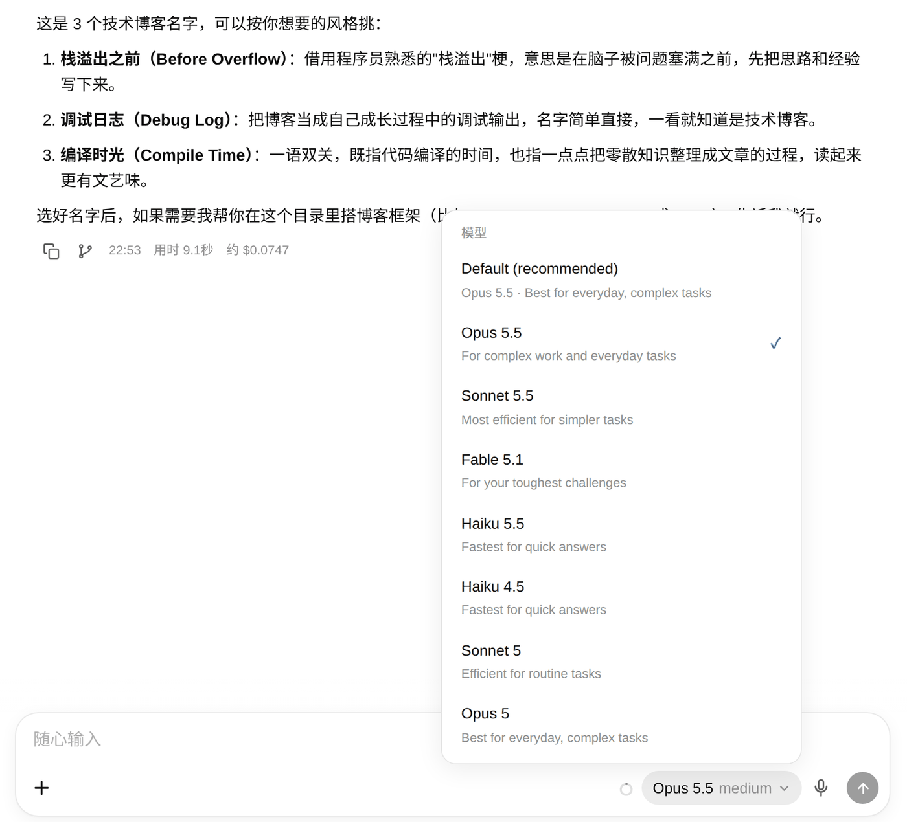<br><sub>点输入框右下角的模型按钮，随时切换模型和思考程度</sub></p>

### 接入飞书机器人（一对一或一对多）

**创建机器人（推荐扫码）：**
1. 打开 **设置 → 飞书机器人**，点「扫码创建新机器人」。
2. 填写机器人名称，在「可用的 Agent」里勾选它能用哪些 agent。
3. 用手机飞书扫描页面上的二维码，在飞书里确认。二维码一般 10 分钟内有效，过期了关掉弹窗重新扫码即可。
4. 页面提示创建成功后，机器人立即可用。在飞书里搜索机器人的名称，发一条消息试试。

> 已经有现成的飞书应用，或者用的是 Lark（飞书国际版），可以点「手动添加」，填写 App ID、App Secret，并在「域名」里选择飞书或 Lark；扫码创建的应用会自动带好所需权限，手动添加的应用需要你自己在飞书开发者后台开通机器人能力、消息和指令相关权限并发布。

**选择绑定方式：**

| 想要的效果 | 怎么配置 |
|---|---|
| 这个机器人专门用 Claude Code | 「可用的 Agent」只勾 Claude Code |
| 这个机器人专门用 Codex | 「可用的 Agent」只勾 Codex |
| 这个机器人两个都能用 | 两个都勾，再在「默认 Agent」里选新会话默认用哪个；聊天时用 `/claude`、`/codex`、`/agent` 切换 |

举个例子：你可以创建「Claude 助手」和「Codex 助手」两个机器人，各绑一个 agent，想用哪个就找哪个聊；也可以只创建一个「AI 助手」，两个 agent 都勾上，按需切换。绑定关系以后随时可以在设置页修改，保存后立即生效。

**让其他人使用：** 其他人给机器人发消息时会收到一个配对码，你在 **设置 → 授权 → 待批准的配对** 里批准后，对方才能使用。也可以把对方的 open_id 直接填进这个机器人的「Owner 白名单」。在群里使用时，群成员也需要先经过批准。

**飞书使用要点：**
- 群聊里要 @ 机器人才会回复；同一个群里的不同话题是各自独立的会话。
- 可以发文字、富文本、图片、文件、语音和视频。
- 输入 `/` 会弹出指令面板。新注册的指令大约 5～8 分钟后生效；在此之前只发一个 `/`，机器人会回一张命令卡片。
- Agent 的思考和工具调用显示在实时刷新的过程卡片里，最终回复是普通消息，方便复制和引用。

### 在飞书里续接 Web 任务

**方式一：在飞书里接上**
1. 在飞书里给机器人发送 `/web`，机器人会列出最近 10 条 Web 会话。
2. 在想继续的会话上点「接上」。
3. 之后你在这个飞书聊天里说的话、发的命令都会进入那条 Web 会话；它的回复、授权请求和提问也会发到飞书，网页上说的话同样会同步过来。

**方式二：从网页发到飞书**
1. 在网页侧栏右键要继续的会话，选择「在飞书继续…」。
2. 选择一个和机器人聊过的飞书聊天（只有一个时会直接接上）。

**结束续接：** 在飞书里发送 `/detach`，或者在 `/web` 列表卡片上点「回到本聊天」，这个飞书聊天就回到它自己原来的会话。如果那条 Web 会话被删除了，飞书这边也会自动退回。

> 续接期间，网页和飞书看到的是同一条会话。回到电脑前直接在网页上接着聊就行，在飞书里说过的话都在。

### 处理授权和提问

Agent 要执行命令或修改文件时会弹出授权卡。不同操作提供的选项略有不同，常见的有：

| 选项 | 效果 |
|---|---|
| 允许一次 | 只放行这一次 |
| 本会话全部允许 | 这条会话里的后续操作不再询问；开新会话或切换会话后恢复逐条确认 |
| 总是允许… | 按钮上会写明放行范围，比如「总是允许 npm 开头的单条命令」。之后同类操作不再询问。Claude Code 的这份名单可以在 **设置 → 授权** 里查看和删除 |
| 拒绝 | 不允许执行 |

<p align="center">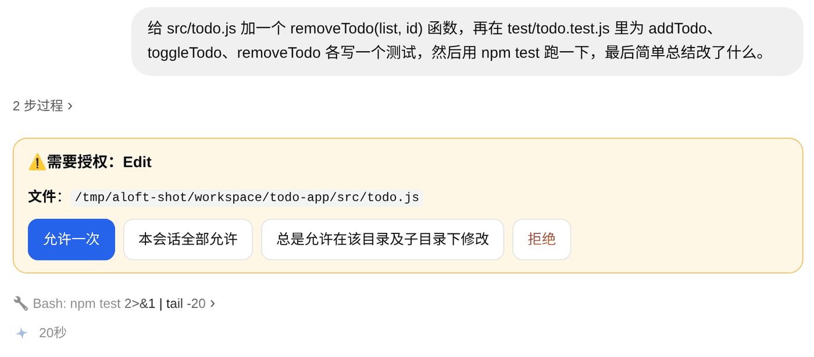<br><sub>授权卡写明要做什么；「总是允许」按钮会标出放行范围</sub></p>

- 想让 Claude Code 放手改代码，发送 `/autoedit on`：修改工作目录内的文件不再询问，Bash 命令和目录外的文件照常询问。发送 `/autoedit off` 关闭。
- Agent 向你提问时，直接在卡片上选择选项或填写回答。
- 授权卡会同时出现在网页和飞书上，在哪边处理都行。
- 授权超时（默认 30 分钟，可在 **设置 → 通用** 里调整）按拒绝处理。

### 分叉：试试另一种做法

觉得某一步之后方向不对，又不想丢掉原来的会话：
- 鼠标移到某条回复上，点「从这里分叉」，会得到一条只保留到这条回复为止的新会话。
- 或者发送 `/fork`，从当前进度分叉。

分叉出来的会话在侧栏里挂在原会话下面，用虚线连接。原会话保持不变。

### 自定义命令

把常用的提示词存成命令，一键调用：

1. 打开 **设置 → 命令**，点「添加命令」。
2. 填写命令名（如 `review`）、说明和提示词。提示词里可以用 `$ARGUMENTS` 代表参数。
3. 之后发送 `/review src/api`，`$ARGUMENTS` 会被替换成 `src/api`；如果提示词里没写 `$ARGUMENTS`，参数会接在提示词后面。

自定义命令按 agent 分开保存，会自动同步到飞书指令面板。在同一个页面里还可以调整 `/` 列表中命令的顺序，以及隐藏不常用的命令。默认内置命令按常用程度排在最前，agent 原生命令（如 Claude 的 skills）排在后面且默认不勾选，需要的话勾上保存即可。

<p align="center">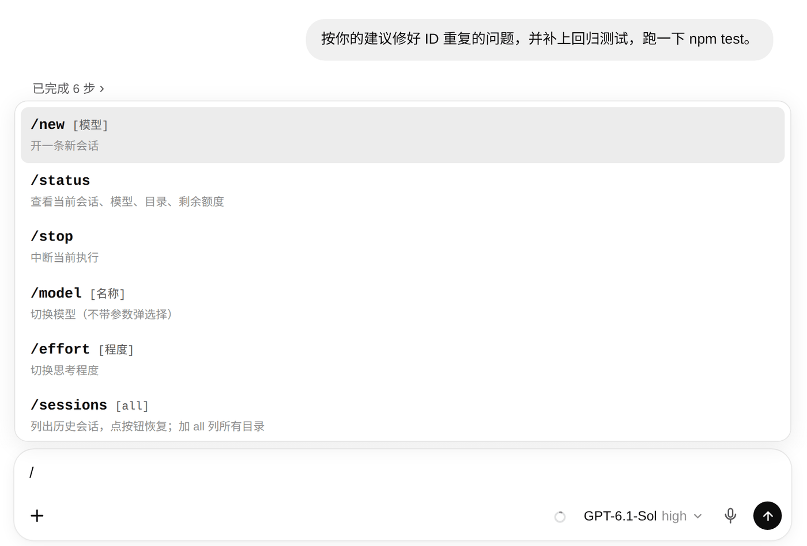<br><sub>在输入框里输入 / 会弹出命令列表</sub></p>

### 开启 iPhone / iPad / Mac 系统推送

**iPhone / iPad：**
1. 用 Safari 打开 Agent Loft 的 HTTPS 地址并登录。
2. 点分享按钮，选择「添加到主屏幕」。
3. **从主屏幕图标打开** Agent Loft，进入 **设置 → 通知**，点「在此设备开启通知」，在系统弹窗里点「允许」。
4. 点「发送测试通知」，确认锁屏上能收到。
5. 之后 Web 会话里 agent 回复完成、出错、需要授权或提问时，锁屏上会收到通知，主屏幕图标上显示未读数。

**Mac：**
- 用 Safari 或 Chrome 打开 Agent Loft，进入 **设置 → 通知**，点「在此设备开启通知」即可；
- 或者直接用 Mac 桌面端，它自带系统通知，不用另外设置。

> 系统推送要求通过 HTTPS 访问（`localhost` 除外），iPhone、iPad 需要 iOS 16.4 或更高版本。在 **设置 → 通知 → 已开启通知的设备** 里可以查看和移除各台设备。飞书会话由飞书自己提醒，你正在前台看着的会话也不会推送。

### 用 Mac 桌面端接入多台服务器

**安装：**
1. 到 [Releases](https://github.com/qijieinnet/agent-loft/releases) 下载 `desktop-v*` 里对应芯片的 DMG（Apple 芯片选 arm64，Intel 芯片选 x64），拖进「应用程序」。
2. 第一次打开如果提示「无法验证开发者」，到 **系统设置 → 隐私与安全性** 里点「仍要打开」（目前还没有 Apple 开发者签名）。
3. 首次启动时，向导会让你决定这台 Mac 的角色：

| 选项 | 适合谁 | 会发生什么 |
|---|---|---|
| **这台 Mac 也作为服务端** | Claude Code、Codex 就在这台 Mac 上跑 | 在「终端」里一键安装 Agent Loft（没有 Node.js 会先用 Homebrew 装上）并设为开机自启，装好后自动连上 |
| **连接这台 Mac 上的 agent-loft** | 这台 Mac 上已经装过 Agent Loft | 直接连上（检测到已在运行时才会出现这个选项） |
| **只连接其他服务器** | Agent 跑在别的电脑、NAS 或云服务器上 | 这台 Mac 只用来操作，接着添加服务器地址即可。以后也可以在设置里安装本机服务端 |

**接入更多服务器：**
1. 点「添加服务器」，选一个图标（emoji），填写地址（如 `http://192.168.1.5:8800` 或 `https://loft.example.com`）和名称（如「家里 Mac mini」）。
2. 在新出现的标签页里登录这台服务器。每台服务器各自登录，互不影响。
3. 重复以上步骤添加更多服务器。点顶部标签切换，拖动标签调整顺序。
4. 鼠标移到菜单栏图标上，就能看到所有服务器的额度、待处理和运行中的会话。

**常用位置：**
- 桌面端设置：菜单栏 **Agent Loft → 设置…**（快捷键 `⌘,`）。里面依次是：服务器列表（拖动排序；展开某台服务器可以查看它的 Agent 环境和版本，并升级服务端）、本机服务端、通用选项（如「本机有会话在跑时不休眠」）、桌面端更新。
- 添加服务器、刷新额度：菜单栏 **服务器** 菜单。
- 检查桌面端更新：菜单栏 **Agent Loft → 检查更新…**。

> 服务器前面有 Cloudflare Access 时，在「添加服务器」里填写额外的登录域名或 Service Token 即可。远程服务器上的 Claude Code、Codex 需要登录时，要 SSH 到那台服务器上执行登录命令。

### 从外网访问

只想在外面用飞书遥控的话，不需要做任何配置。想在外面用网页，或者想用系统推送和语音输入，就需要一个 HTTPS 地址。常见的做法有两种，任选其一：

| 做法 | 适合谁 | 要点 |
|---|---|---|
| **Cloudflare Tunnel** | 没有公网 IP，或者不想折腾端口映射 | 在服务端装好 `cloudflared`，把一个域名指向 `http://localhost:8800`。可以再配合 Cloudflare Access 加一层登录保护，Mac 桌面端也支持 |
| **反向代理**（如 Lucky、Nginx、Caddy） | 有公网 IP 或 DDNS，家里有软路由或 NAS | 申请 HTTPS 证书，把域名反向代理到 `http://<服务端 IP>:8800` |

配置时注意：
- **不要**把 8800 端口直接映射到公网，一定要经过 HTTPS。
- 反向代理和 Agent Loft 不在同一台机器上时，把反向代理的 IP 加进配置文件 `~/.agent-loft/config.json` 的 `web.trustedProxies`（在同一台机器上的话不用改）。
- 在 **设置 → 系统 → 网络访问** 里可以关闭局域网访问或修改端口，改完立即生效。改了端口，记得同步修改反向代理或隧道的配置。

### 升级

- **服务端**：在 **设置 → 系统 → 服务端版本** 里，有新版本时点「升级」。以系统服务运行时会自动重启，打开着的页面会自动刷新。
- **桌面端**：菜单栏 **Agent Loft → 设置…** → 更新，点「更新并重启」。在同一个设置页的服务器列表里展开某台服务器，也可以点「升级服务端」。

> 在线升级只支持用 `npm install -g` 安装的服务端；从源码运行的，请用 `git pull` 更新。

### 从旧版桥接器迁移

如果你之前用过 `feishu-claude-bridge` 或 `feishu-codex-bridge`：

```bash
agent-loft import --dry-run       # 先预览会导入哪些内容
systemctl --user disable --now feishu-claude-bridge feishu-codex-bridge   # 同一个机器人不能被两个程序同时连接
agent-loft import                 # 导入机器人凭据、白名单、配对、会话绑定和「总是允许」名单
agent-loft service install
```

导入后，飞书里原来的会话可以直接接着聊。

### 卸载

```bash
agent-loft service uninstall      # 先移除开机自启服务
npm uninstall -g agent-loft       # 再卸载程序
rm -rf ~/.agent-loft              # 可选：删除配置、会话记录和日志（早期版本的目录是 ~/.im-agent）
```

Claude Code、Codex 自己的登录信息和会话记录不受影响。Mac 桌面端直接从「应用程序」里删除即可。

---

## 功能清单

按模块列出全部功能，方便查阅。各功能的用法见上面的[使用指南](#使用指南)。

### 对话体验（Web / 手机）

| 功能 | 说明 |
|---|---|
| 流式回复 | 回复逐字显示，支持 Markdown 和代码高亮；思考过程和工具调用可以折叠 |
| 自动标题 | 会话标题由 agent 自动生成，双击可重命名 |
| 附件 | 粘贴、拖拽上传，手机上可以直接拍照；附件可以预览和下载 |
| 语音输入 | 点输入框旁的麦克风按钮，使用浏览器自带的语音识别 |
| 模型与思考程度 | 在输入框右下角切换，按钮上显示实际使用的模型，如「Opus 5.5 high」 |
| 上下文占用 | 输入框里的小圆环显示上下文窗口用量，鼠标悬停可看已用和剩余 token |
| 用时与费用 | 每条回复下方显示用时、费用和完成时间 |
| 从这里分叉 | 从任意一条回复分叉出新会话，原会话不受影响 |
| 断线续传 | 手机切到后台再回来会自动重连，补上错过的内容 |
| 命令补全 | 输入 `/` 弹出命令列表，包含内置命令、自定义命令，以及在设置里勾选的 agent 原生命令（如 Claude 的 skills） |

### 会话管理

| 功能 | 说明 |
|---|---|
| 侧栏分组 | 分「最近」和「项目」两组：Web 会话按工作目录归类，每个飞书机器人单独一行 |
| 分叉树 | 分叉出来的会话挂在原会话下面，用虚线连起来 |
| 状态提示 | 正在运行的会话显示转圈，等你处理的会话显示提示点 |
| 目录选择 | 在目录树里逐层点选工作目录；新对话发出第一条消息前就能选好 |
| 历史会话 | `/sessions` 列出历史会话，点一下就能恢复 |
| 订阅额度 | 侧栏底部显示 Claude / Codex 的 5 小时和 7 天额度，以及多久后重置 |

### 飞书

| 功能 | 说明 |
|---|---|
| 多个机器人 | 机器人数量不限，每个可以对应一个 agent，也可以对应多个 |
| 扫码创建 | 在 Web 设置页用飞书扫码，自动填好 App ID、App Secret，扫码人自动加入白名单 |
| 私聊和群聊 | 私聊直接对话；群里要 @ 机器人；不同话题是各自独立的会话 |
| 消息类型 | 支持文字、富文本、图片、文件、语音和视频 |
| 过程卡片 | 思考和工具调用显示在实时刷新的卡片里；最终回复是普通消息，方便复制和引用 |
| 指令面板 | 自动注册到飞书的 `/` 指令面板；只发一个 `/` 会回一张可以点的命令卡片 |
| 配对 | 陌生人发消息会拿到配对码，你在设置页批准后对方才能使用 |
| 续接 Web 会话 | `/web` 接上一条 Web 会话，`/detach` 回到这个聊天自己的会话 |

### 通知

| 功能 | 说明 |
|---|---|
| 飞书消息 | 回复、授权卡、提问卡直接发到飞书聊天，在卡片上点一下就能处理 |
| 苹果系统推送 | Web 会话回复完成、出错、需要授权或提问时，推送到 iPhone、iPad 锁屏和 Mac 通知中心；Android、Windows 同样支持。采用标准 Web Push，不需要苹果开发者账号 |
| 图标角标 | 主屏幕图标、桌面 PWA 图标、桌面端程序坞图标上显示未读数 |
| 按设备管理 | 在 **设置 → 通知** 里逐台设备开启或关闭，可以发送测试通知 |

### Mac 桌面端

| 功能 | 说明 |
|---|---|
| 多服务器 | 顶部标签栏切换服务器，可以拖动排序；每台各自登录，切走后仍在后台保持连接 |
| 菜单栏 | 悬停查看各服务器的额度、待处理和运行中的会话；双击打开主窗口 |
| 系统通知 | 回复完成、需要授权时弹出 macOS 通知；关掉窗口也照常提醒 |
| 防休眠 | 可选开启：本机有会话在运行时，Mac 不进入休眠 |
| 额度统一查询 | 同一个账号只查一次，避免重复请求 |
| Cloudflare Access | 验证页直接在窗口里完成，过期会提醒；也可以配置 Service Token 免验证 |
| 本机即服务端 | 首次打开时可以选「这台 Mac 也作为服务端」，一键安装并设为开机自启 |
| 升级 | 在设置的服务器列表里一键升级各台服务端；桌面端自己的更新也在设置里完成 |

---

## 命令速查

### 聊天命令（Web 和飞书通用）

| 命令 | 作用 |
|---|---|
| `/new [模型]` | 开一条新会话 |
| `/status` | 查看当前会话、模型、目录和剩余额度 |
| `/stop` | 中断当前执行 |
| `/model [名称]` | 切换模型，不带参数时弹出选择 |
| `/effort [程度]` | 切换思考程度 |
| `/agent [名称]` | 查看或切换 agent |
| `/claude`、`/codex` | 直接切换到 Claude Code 或 Codex |
| `/sessions [all]` | 列出当前目录的历史会话，加 `all` 列出所有目录 |
| `/resume <会话ID>` | 恢复指定会话 |
| `/fork` | 从当前会话分叉 |
| `/cd <相对目录>` | 切换工作目录（只能在工作目录之内） |
| `/pwd` | 显示当前工作目录 |
| `/autoedit [on\|off]` | 自动允许 Claude Code 修改工作目录内的文件 |
| `/chat` | 切到聊天模式：精简、只能联网搜索，每轮开销小很多 |
| `/work` | 切到工作模式：agent 原装的全部能力 |
| `/approve <请求ID> <决定>` | 授权卡失效时，手动审批 |
| `/help` | 显示帮助 |

**仅飞书可用：** `/web`（接上一条 Web 会话）、`/detach`（回到这个聊天自己的会话）、`/bind <绑定码>`（把飞书账号绑定到你的 agent-loft 用户，只能在私聊里发）

除了以上命令，你添加的自定义命令也在 `/` 列表里；agent 原生的命令（如 Claude 的 skills、`/compact`）默认不在列表里，可以在 **设置 → 命令** 里勾选，没勾选的也照样可以直接输入。

### 终端命令

| 命令 | 作用 |
|---|---|
| `agent-loft start` | 前台启动 |
| `agent-loft service install \| uninstall \| restart \| status` | 管理开机自启服务 |
| `agent-loft doctor` | 体检：检查配置、agent 和飞书连通性 |
| `agent-loft passwd [新密码] [--user 用户名]` | 重置 Web 登录密码（默认是最早的管理员），他的设备全部下线 |
| `agent-loft user list \| add <用户名> [--admin] \| passwd <用户名> \| role <用户名> admin\|member \| disable \| enable \| remove` | 管理 Web 登录用户 |
| `agent-loft pair list \| approve <码> \| revoke <机器人id> <open_id>` | 管理飞书配对 |
| `agent-loft import` | 从旧版桥接器导入 |

`aloft` 是 `agent-loft` 的简写，两者完全等价。

---

## 设置页一览

| 标签页 | 可以做什么 |
|---|---|
| 通用 | 工作目录、授权超时、会话闲置多久自动换新、额度自动刷新间隔 |
| Agent | 运行环境检查、启用或停用各 agent、默认模型和思考程度、模型列表显示哪些、Codex 路径和沙箱 |
| 命令 | 调整 `/` 列表的顺序和显示、添加和编辑自定义命令 |
| 飞书机器人 | 扫码创建或手动添加机器人、选择可用 agent 和默认 agent、Owner 白名单 |
| 授权 | 批准或撤销飞书配对、管理 Claude 的「总是允许」名单 |
| 记忆 | 开关记忆；什么时候整理、用哪个 agent 和模型、现在整理；参考以前的聊天；编辑「关于我」；查看 / 编辑 / 删除记住的事；清空聊天记录索引、清空全部记忆（每个人只看得到自己的） |
| 通知 | 为本设备开启系统通知、查看和管理已开启通知的设备 |
| 账号 | 当前账号、修改自己的登录密码、绑定 / 解除飞书账号、查看已登录的设备并让其下线、退出登录 |
| 用户 | 添加用户、重置密码、设为管理员 / 成员、停用、清空记忆、解除飞书绑定、删除（仅管理员；看不到成员记忆的内容） |
| 系统 | 查看版本和运行时长、重启服务、服务端版本和升级、局域网访问和端口 |

普通成员的设置里只有「记忆」「通知」和「账号」三页，其余都只有管理员能看到。

---

## 常见问题

### Agent Loft 会把我的代码上传到别处吗？

不会。Agent Loft 运行在你自己的机器上，只把 agent 的输入输出转发给你的浏览器和飞书。代码只会发送给你本来就在用的 Claude 和 Codex 服务。

### 需要额外付费吗？

Agent Loft 本身是 MIT 协议的开源软件，免费使用。Claude Code 和 Codex 按你自己的订阅或 API 计费，侧栏会显示订阅额度，每条回复下方会显示费用。

### 切换 agent 后，新的 agent 知道之前聊了什么吗？

不知道。每个 agent 只记得自己的对话，但它们共用同一个工作目录，能看到彼此改过的文件。需要的话，把关键信息简单转述一下即可。

### 聊天模式和工作模式有什么区别？

输入框右下角的「💬 聊天 / 🛠 工作」，或者发 `/chat`、`/work` 切换，同一条对话接着聊。

- **工作模式**：Claude Code / Codex 原装的样子，能执行命令、改文件、用技能和 MCP。
- **聊天模式**：换成精简的系统提示，只留联网搜索，不执行命令、不读写这台机器上的文件（图片、PDF、文本附件的内容直接放进消息里）。每轮固定要带的内容少得多，实测一句话 Claude 约 1.6 万 → 2 千 token，Codex 约 2 万 → 1.2 万，回得也更快。适合日常聊天、查资料、问问题。

切换后第一轮要重建提示缓存，会稍贵一些；在工作模式里读过的大段内容也还留在对话历史里。纯聊天的话题，开一条新的聊天模式对话最省。

### Agent 能记住我吗？

能，在 **设置 → 记忆** 里打开（默认开）。和 ChatGPT 的记忆类似：

- 「关于我」：自己写一段，每次对话都会带上。
- 记住的事：聊天时说「记住……」，或者 agent 发现了长期有用的信息（身份、偏好、在做的事），会自己记一条并在回复里告诉你；记错了说「忘掉……」或者在设置里删。
- 自动整理：后台把你新聊的内容读一遍，补充新的、更新变了的、删掉过时的。你自己加的条目它不会动。会占用一点订阅额度。在设置里可以选：
  - **什么时候整理**：每天一次（默认凌晨 4 点，把当天聊过的合起来一次整理，最省）、每段对话聊完后（停多久可选，改了什么会在那条对话里告诉你）、只在你点「现在整理」时、不整理；
  - **用哪个 agent 的哪个模型**：默认 Claude 的 Haiku，没装 Claude 就用 Codex 的默认模型（思考程度 low）；整理只是读一遍、改几条，便宜的模型就够了。
  - 设置页会显示上次整理的时间、用的模型和改了几条，还有多少段对话等着整理。
- 参考以前的聊天：你说「上次跟你说的那个……」时，agent 会去搜你以前的对话（只有你自己的，删掉的对话不算）。第一次用时会把已有的对话收录进来；设置里能看到收录了多少，也能清空。
- Claude 和 Codex、Web 和飞书共用同一份。在设置里改了之后，下一条消息就用上新的。

记忆只用在**有主人的对话**里：你在 Web 上的对话，以及绑定了飞书账号后和机器人的私聊（设置 → 账号 → 飞书账号）。飞书群聊不用，群里不止一个人。每个人的记忆只有自己看得到，管理员只能清空；删掉用户时记忆一起删除。

> 和多用户一样，这不是安全隔离：工作模式下 agent 能读到这台机器上的文件，也包括记忆文件。

### 为什么 agent 突然不记得之前的内容了？

通常是这几种情况：会话闲置超过 12 小时，自动开了新会话（用 `/sessions` 可以恢复）；用 `/cd` 切换了工作目录；切换到了另一个 agent。

### 家里没有公网 IP，能在外面用吗？

能。最简单的是用飞书：机器人由服务端主动连向飞书，不需要公网 IP 和端口映射。想在外面用网页，可以用 Cloudflare Tunnel，它同样不需要公网 IP，见 [从外网访问](#从外网访问)。

### 电脑关机或休眠了还能用吗？

不能。服务端必须保持开机并联网。用 Mac 当服务端的话，可以在桌面端开启「本机有会话在跑时不休眠」，或者在系统设置里调整休眠策略。

### 可以多人一起用吗？

可以，有两种方式：

- **Web 多用户**：管理员在 **设置 → 用户** 里给别人建账号（成员或管理员）。每个人只看得到自己的对话、授权卡、通知和记忆；设置只有管理员能改；飞书机器人和飞书里的对话也只有管理员能看到（绑定了账号的私聊除外）；会对所有人生效的「总是允许」按钮只有管理员能点，成员用「允许一次」或「本会话全部允许」。只有一个用户时，登录页和以前一样只要输入密码。
- **飞书**：别人给机器人发消息拿到配对码，你批准后对方就能用。他在 Web 上也有账号的话，可以在 **设置 → 账号 → 飞书账号** 生成绑定码，再在飞书私聊机器人发 `/bind 绑定码`：之后这个私聊就是他的个人会话（用他的记忆，管理员在 Web 上也看不到），群聊照旧是管理员的。

> ⚠️ 多用户是「信任型」的，**不是安全隔离**。所有 agent 都以服务端上的同一个系统用户运行，任何用户都可以让 agent 读这台机器上的文件（包括别人的对话记录、配置里的飞书密钥），大家用的也是同一个 Claude / Codex 订阅。只把账号给你信任的人。需要真正隔离的话，给每个人用各自的系统用户跑一份 agent-loft（端口不同），桌面端可以同时连多台。

### 手机收不到推送怎么办？

先在 **设置 → 通知** 里点「发送测试通知」。收不到的话，确认三点：通过 HTTPS 访问；iPhone 系统是 iOS 16.4 或更高版本，并且是从主屏幕图标打开的；系统设置里允许了 Agent Loft 的通知。测试通知能收到、平时却没收到的话，可能是那条会话是飞书会话（由飞书提醒），或者你当时正开着那条会话。

### 飞书里输入 `/` 没有弹出指令面板？

新注册的指令大约需要 5～8 分钟生效。在此之前，只发一个 `/` 也能收到可点击的命令卡片。

### 忘记登录密码了？

在服务端的终端里运行 `agent-loft passwd` 重置管理员的密码，他所有已登录的设备会被下线。其他用户用 `agent-loft passwd --user 用户名`，或者让管理员在 **设置 → 用户** 里点「重置密码」。

---

## 故障排查

遇到问题，先运行 `agent-loft doctor` 体检，再到 **设置 → Agent** 查看运行环境，然后对照下表：

| 现象 | 可能的原因和解决办法 |
|---|---|
| 其他设备打不开页面 | 确认 **设置 → 系统 → 网络访问** 里允许了局域网访问；确认服务端防火墙放行了 8800 端口；确认两台设备在同一个网络里 |
| 页面提示设置码不对 | 设置码是日志里打印的 12 位字母和数字，不区分大小写。找不到就运行 `agent-loft passwd` 直接设置密码 |
| 新对话里看不到某个 agent | 它没有安装、没有登录，或者在 **设置 → Agent** 里被停用了。按页面提示处理后点「重新检查」 |
| 以系统服务运行时提示找不到 codex | 系统服务的 PATH 很短。在终端运行 `command -v codex` 查到完整路径，填进 **设置 → Agent → codex 可执行文件** |
| 飞书机器人不回复 | 检查：机器人在设置里是否启用；群聊里有没有 @ 它；发消息的人是否已通过配对；`agent-loft doctor` 里飞书连通性是否正常 |
| 飞书卡片上的按钮点了没反应 | 卡片可能已经失效。卡片正文里有请求 ID，发送 `/approve <请求ID> allow-once`（或 `deny`）手动处理 |
| 开启通知时提示权限被拒绝 | 之前在系统弹窗里点了拒绝。iPhone 到 **设置 → 通知 → Agent Loft** 里重新打开；电脑到浏览器的网站设置里重新允许 |
| 语音输入按钮不能用 | 语音输入需要 HTTPS，并在浏览器里允许使用麦克风；目前支持 Chrome、Edge、Safari |
| 升级按钮是灰的，或者升级后没变化 | 在线升级只支持 `npm install -g` 安装的服务端。在前台手动运行的，升级后需要自己重启 |

还是解决不了的话，查看 `~/.agent-loft/logs/err.log` 里的错误信息，并欢迎到 [GitHub Issues](https://github.com/qijieinnet/agent-loft/issues) 反馈。

---

<p align="center">Agent Loft · MIT License · <a href="https://github.com/qijieinnet/agent-loft">github.com/qijieinnet/agent-loft</a></p>
